# Software Design Document (SDD)

AI Assisted Child Development Platform

**Team name:** Group 11  
**Version:** ☑ First version (Week 6) ☐ Final (Week 10)  
**Last updated:** 2026-11-08

**Repository:** [child-development-app-group11](https://github.com/NasserN11/child-development-app-group11)

This document describes how Group 11 will build a shared schedule, task list and development record for parents, specialists and children.

**Implemented in main.** At [commit 362dd13](https://github.com/NasserN11/child-development-app-group11/tree/362dd1319b65fdf3350df6ba032dd4d30a52dc88), the Express server reads tasks from SQLite and returns them as JSON through GET /api/tasks. The seed script creates three example tasks. The GitHub Actions workflow sets up Node.js 22 and prints a placeholder message.

**Target design.** The architecture diagram, technology stack and wireframes below specify the intended M1–M8 system. Planned work includes the React interface, JWT and child access checks, task updates, specialist records, AI summaries and automated tests.

**Revision marks.** An asterisk (\*) identifies a choice made for this design. On a wireframe title it covers the layout, example data and interactions.

---

## 1. Architecture Overview

The React client sends requests to a local Express API. The API reads and writes synthetic records in SQLite and enforces the permissions in the access matrix. Its AI module calls the Gemini API\* for weekly summaries and uses a deterministic mock for automated tests.

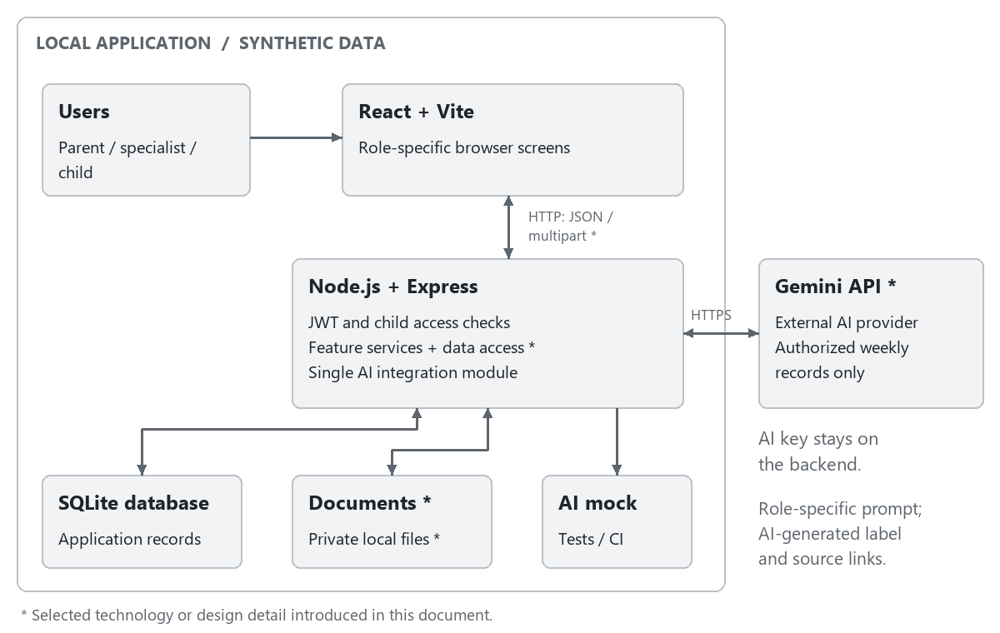

Figure 1 Architecture overview

### Responsibilities and Trust Boundaries\*

The browser collects input, displays authorized results and manages loading and validation states\*. React components share an authenticated session and selected-child context\*, so navigation preserves the user's current workspace. Frontend route guards\* select the correct screens, while the API remains the authority for every data operation.

Express route handlers parse requests. Middleware checks identity and child access before feature services apply business rules and issue parameterized queries\*. Each successful write returns the saved record\* so the browser can display the stored result.

Express keeps uploaded files in a private local directory\* and serves them through protected download routes\*. The AI provider key stays on the server.

### Access Control

| **Operation**                       | **Parent** | **Linked specialist** | **Child** |
|-------------------------------------|------------|-----------------------|-----------|
| View a child's weekly schedule      | Own child  | Linked child          | Self only |
| Add events and assign tasks         | Own child  | Linked child          | No        |
| Mark a task done                    | No         | No                    | Own task  |
| Link or unlink specialists          | Own child  | No                    | No        |
| Read specialist observations        | Own child  | Linked child          | No        |
| Add specialist observations         | No         | Linked child          | No        |
| Upload, view and download documents | Own child  | Linked child          | No        |
| View weekly statistics              | Own child  | Linked child          | No        |
| Request a role-specific AI summary  | Own child  | Linked child          | No        |

For each request, the API verifies the JWT and checks the requested action against the matrix. It matches a parent to an owned child, a specialist to an active link, or a child account to its own profile. This check also protects downloads and AI source links. Once a parent removes a specialist link, the next request for that child is denied even if the token is still valid.

### Persistence and Consistency\*

SQLite stores the application's structured records, and a seed script supplies synthetic users and feature data. Related writes use database transactions\*, and stored relationships use foreign-key constraints\*. New tasks begin as Pending\*; when the child marks one Done, the server stores the update before the UI confirms completion\*. The assigner's next retrieval reads that same saved state\*. Observation edits retain the original entry date and set an edited flag\* so that the required Edited label remains reliable.

For weekly statistics, the selected week runs from Monday through Sunday in the Europe/Istanbul application time zone\*. The denominator is the number of tasks whose due date falls in that week\*, and the numerator is the number of those tasks currently marked Done\*. The same calculation is applied separately to each development area\*. Three completed tasks out of five therefore produce 60%. A week or area with no tasks displays No tasks rather than dividing by zero\*. These selection rules are shared by the dashboard and AI input builder\*.

Documents use generated storage names\*, while SQLite records their original name, verified type, uploader, child and upload date\*. File size and content are validated before the upload is accepted\*. If saving the metadata fails, the new file is removed\*; a failed upload must not appear as a successful document row\*. This prevents a visible record from referring to a missing or rejected file.

### Technology Stack

| **Layer**         | **Selected technology**                                               | **Purpose**                                                                                                                                       |
|-------------------|-----------------------------------------------------------------------|---------------------------------------------------------------------------------------------------------------------------------------------------|
| Frontend          | React, Vite; JavaScript\*, React Router\*, CSS\*                      | Build the browser interface, role-specific navigation and reusable screen components.                                                             |
| API communication | HTTP REST with JSON; browser Fetch API\*                              | Exchange application data with Express; use multipart requests for document uploads\*.                                                            |
| Backend           | Node.js 22, Express; JavaScript with CommonJS                         | Provide the local API. Node.js 22 matches the repository's CI configuration; CommonJS matches the existing backend.                               |
| Database          | SQLite using the existing sqlite3 package                             | Persist users, child profiles, specialist links and feature records; initialize synthetic data with a seed script.                                |
| Authentication    | JWT; jsonwebtoken\* and bcryptjs\*                                    | Sign and verify access tokens and hash passwords. Keep access tokens in frontend memory\* and send them as Bearer tokens\*.                       |
| Documents         | Multer\*; private local file storage\*                                | Accept PDF and image uploads, validate file content and serve authorized downloads.                                                               |
| AI integration    | Gemini API\* using the Google Gen AI JavaScript SDK (@google/genai)\* | Generate role-specific weekly summaries through the backend. A configurable model identifier\* keeps model changes inside the integration module. |
| Testing           | Jest, Supertest, Vitest, Playwright                                   | Test backend logic, API permissions, frontend behavior and complete user journeys. Use the mandatory AI mock in automated tests.                  |
| CI                | GitHub Actions                                                        | Run checks for pull requests and changes to main; extend the existing workflow with the required test suites.                                     |

The server reads the JWT signing secret and AI key from environment variables\*. Token expiry opens sign-in\*, and signing out clears the in-memory token\*.

Technology references: [Google Gen AI SDK](https://github.com/googleapis/js-genai), [React Router](https://reactrouter.com/start/declarative/installation), [jsonwebtoken](https://github.com/auth0/node-jsonwebtoken), [bcryptjs](https://github.com/dcodeIO/bcrypt.js), [Multer](https://github.com/expressjs/multer).

### Selection Rationale\*

React components share forms, tables and feedback controls\* across the three workspaces. Using the browser Fetch API\* keeps network requests within the standard browser runtime.

The existing sqlite3 driver and local database let the team extend the task endpoint without provisioning another service. bcryptjs\* keeps password hashing in JavaScript.

The live adapter and the AI mock share one interface\*. Tests can supply a known response, then check the displayed summary and its source links. Reviewing a live summary against the records it cites also checks factual accuracy.

### AI Integration and Operational Behavior

The API selects the authorized records for the requested week, applies the parent or specialist prompt and attaches stable source identifiers\*. It returns the AI-generated summary with a server-maintained list of links to those records\*. The provider summarizes recorded activity. Diagnosis, treatment and decisions about a child remain outside its scope.

The UI shows the selected child, week and AI-generated label beside the summary\*. Changing the child or week clears the previous summary until the matching result is available\*. An empty set of source records produces a No records for this week message\*. Provider failures display a retry action\* while the rest of the workspace remains available. An in-flight result is discarded if the user's child selection has changed\*.

| **Condition**                                 | **API and screen behavior**                                                                  |
|-----------------------------------------------|----------------------------------------------------------------------------------------------|
| Missing or invalid input                      | Reject the write and show field-specific validation feedback\*.                              |
| Expired or invalid login token                | Return HTTP 401\* and open sign-in\*; do not expose protected records.                       |
| User lacks permission for the child or action | Return HTTP 403\* and an access message\*; clear protected content from that workspace\*.    |
| Authorized record no longer exists            | Return HTTP 404\* and refresh the affected list\*.                                           |
| Database write or document upload fails       | Show failure\* and keep valid form input\*; do not display a success confirmation.           |
| AI provider is unavailable                    | Return HTTP 503\* for the summary request and offer retry\*; core features continue to work. |

---

## 2. Module Design

Each module is built as a vertical slice: a React screen, an Express route, a service that applies the business rules, and a data access function that runs SQL. Component names below are proposed and can be adjusted during implementation. Requirement IDs refer to the SRS.

| Module | Main components | Implements requirements |
|---|---|---|
| M1 – Login, Registration and Roles | **Backend:** `authRoutes`, `authService` (registration, login, bcryptjs hashing, JWT creation), `authenticate` middleware (verifies the JWT), `authorizeChildAccess` middleware (parent owns child, specialist is linked, or child is self), `userRepository`, `childRepository` **Frontend:** `LoginPage`, `RegisterPage`, `CreateChildForm`, `AuthContext` (session kept in memory), role-based route guards and navigation | FR-M1-01 to FR-M1-12, NFR-02, NFR-07 |
| M2 – Linking Specialists | **Backend:** `linkRoutes`, `linkService` (link by email, unlink, duplicate check), `linkRepository` (also read by `authorizeChildAccess` on every request) **Frontend:** `LinkedSpecialistsPage`, `LinkSpecialistForm`, `UnlinkConfirmPanel` | FR-M2-01 to FR-M2-08 |
| M3 – Weekly Schedule | **Backend:** `eventRoutes`, `eventService` (end time after start time, creator-only edit and delete), `eventRepository`, shared `weekUtils` (Monday to Monday week in Europe/Istanbul) **Frontend:** `WeeklySchedulePage`, `WeekSelector`, `EventForm`, read-only schedule view for the child | FR-M3-01 to FR-M3-09 |
| M4 – Tasks | **Backend:** `taskRoutes`, `taskService` (pending on creation, development area check, child marks own task done, assigner changes due date), `taskRepository` **Frontend:** `TaskForm`, `AssignedTaskList` (assigner sees status), `ChildTaskList` (mark as done) | FR-M4-01 to FR-M4-11 |
| M5 – Specialist Entries | **Backend:** `observationRoutes`, `observationService` (sets the `edited` flag, only the author edits), `observationRepository` **Frontend:** `ObservationForm`, `ObservationList` (shows the "Edited" label) | FR-M5-01 to FR-M5-07 |
| M6 – Documents | **Backend:** `documentRoutes`, `documentService` (checks PDF, PNG or JPEG content and the 10 MB limit, removes the file if saving metadata fails), Multer upload middleware, `documentRepository`, private local upload directory, protected download route **Frontend:** `DocumentsPage`, `UploadForm`, `DocumentList` | FR-M6-01 to FR-M6-07 |
| M7 – Weekly Statistics | **Backend:** `statsRoutes`, `statsService` (completion rate in total and per development area, "No tasks" when a week or area is empty), `weekUtils`, `taskRepository` queries **Frontend:** `WeeklyStatsPanel` | FR-M7-01 to FR-M7-09 |
| M8 – Role-Based AI Summary | **Backend:** `aiRoutes`, `aiSummaryService` (selects the authorized records of the week and their source ids), `promptBuilder` (separate parent and specialist prompts), `aiModule` interface with `geminiAdapter` and `mockAdapter`, `contentGuard` (rejects diagnoses, treatments and decisions), 15 second timeout, `aiSummaryRepository` (feedback) **Frontend:** `AiSummaryPanel` ("AI-generated" label and disclaimer), `SourceLinks`, `FeedbackButtons`, retry action | FR-M8-01 to FR-M8-18, NFR-06 |

### Shared components

| Component | Used by | Purpose |
|---|---|---|
| `authenticate`, `authorizeChildAccess` | M1 to M8 | One place for identity and child-access checks, so no route can skip them |
| `weekUtils` | M3, M7, M8 | One definition of a calendar week, so the schedule, statistics and AI input select the same records |
| Error handler | M1 to M8 | Returns the standard status codes (400, 401, 403, 404, 409, 503) |
| Seed script | All | Creates synthetic users, children, links and sample records |

---

## 3. Data Model

The database is SQLite. Every record about a child (events, tasks, observations, documents, AI summaries) belongs to exactly one child. Access to a child's data is decided by the parent link (`children.parent_id`), the child's own login (`children.user_id`), or a row in `specialist_links`.

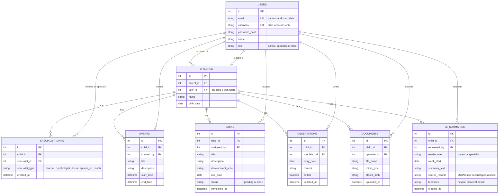

### Constraints and rules

| Entity | Rule |
|---|---|
| USERS | Parents and specialists have a unique `email`; child accounts have a unique `username` instead. Passwords are stored only as a salted hash. `role` is one of `parent`, `specialist`, `child`. |
| CHILDREN | Each child has exactly one parent and exactly one child login (`user_id` is unique). |
| SPECIALIST_LINKS | The pair (`child_id`, `specialist_id`) is unique. Unlinking deletes the row, so access ends immediately. |
| TASKS | `development_area` is one of Cognitive, Language, Social-Emotional or Motor. Statistics count a task in the week of its `due_date`. `status` is `pending` or `done`. Only the child marks a task done. |
| OBSERVATIONS | `edited` is set to true when an entry is changed after creation. The child cannot read this table. |
| DOCUMENTS | Only PDF, PNG and JPEG files up to 10 MB are accepted. The file is stored on disk under a generated name; the database keeps the path. The child cannot read this table. |
| AI_SUMMARIES | `source_records` lists the records used, so the screen can link each summary to them. Summaries are labelled "AI-generated" on screen. |

---

## 4. API / Interfaces

All endpoints are under `/api`, send and receive JSON (except file upload and download), and need a JWT in the `Authorization: Bearer <token>` header, except registration and login. Tokens expire within 60 minutes.

**Access rule for every `/api/children/:childId/...` endpoint.** The backend does not trust the role in the token alone. On each request it checks the current database state:

- **Parent:** `children.parent_id` equals the user's id.
- **Linked specialist:** a row exists in `specialist_links` for this child and this specialist.
- **Child:** `children.user_id` equals the user's id.

If the check fails, the API returns `403 Forbidden` and does nothing. This is how an unlinked specialist is blocked even when their token has not expired.

| Method | Endpoint | Description | Allowed roles | Module |
|---|---|---|---|---|
| POST | `/api/auth/register` | Register a parent or specialist (unique email and password) | public | M1 |
| POST | `/api/auth/login` | Log in with email (parent, specialist) or username (child); returns a JWT and the user's role | public | M1 |
| GET | `/api/me` | Current user and role | all logged-in users | M1 |
| POST | `/api/children` | Create a child account (name, unique username, password) linked to the calling parent | parent | M1 |
| GET | `/api/children` | Children the user may access (own children, linked children, or own profile) | all | M1, M2 |
| GET | `/api/children/:childId/specialists` | List linked specialists | parent | M2 |
| POST | `/api/children/:childId/specialists` | Link a registered specialist by email and type; `404` if the email is not a registered specialist, `409` if already linked | parent (owner) | M2 |
| DELETE | `/api/children/:childId/specialists/:specialistId` | Unlink a specialist | parent (owner) | M2 |
| GET | `/api/children/:childId/events?weekStart=YYYY-MM-DD` | List events of a week (by start time) | parent, linked specialist, child | M3 |
| POST | `/api/children/:childId/events` | Add an event; `400` if the end time is not after the start time | parent, linked specialist | M3 |
| PATCH | `/api/children/:childId/events/:eventId` | Edit an event | event creator | M3 |
| DELETE | `/api/children/:childId/events/:eventId` | Delete an event | event creator | M3 |
| GET | `/api/children/:childId/tasks?weekStart=YYYY-MM-DD` | List tasks (optionally by week) with status | parent, linked specialist, child | M4 |
| POST | `/api/children/:childId/tasks` | Assign a task (title, description, development area, due date); starts as pending | parent, linked specialist | M4 |
| PATCH | `/api/children/:childId/tasks/:taskId` | Child: mark own task done. Assigner: change the due date of a task they created | child, task assigner | M4 |
| GET | `/api/children/:childId/observations` | List observations | parent, linked specialist | M5 |
| POST | `/api/children/:childId/observations` | Add a dated observation | linked specialist | M5 |
| PATCH | `/api/children/:childId/observations/:obsId` | Edit an observation; sets `edited` to true | the specialist who wrote it (while linked) | M5 |
| GET | `/api/children/:childId/documents` | List documents (name, type, uploader, date) | parent, linked specialist | M6 |
| POST | `/api/children/:childId/documents` | Upload a PDF, PNG or JPEG up to 10 MB (multipart) | parent, linked specialist | M6 |
| GET | `/api/children/:childId/documents/:docId/download` | Download or view a file | parent, linked specialist | M6 |
| GET | `/api/children/:childId/stats?weekStart=YYYY-MM-DD` | Weekly completion rate, in total and by development area ("No tasks" when empty) | parent, linked specialist | M7 |
| POST | `/api/children/:childId/ai-summary` | Generate the week's summary for the caller's role (body: `weekStart`); returns text, "AI-generated" label, disclaimer and source records | parent (owner), linked specialist | M8 |
| PATCH | `/api/children/:childId/ai-summary/:summaryId` | Save feedback (`helpful` or `incorrect`) | parent, linked specialist | M8 |

### Standard responses

| Status | Meaning |
|---|---|
| 200 / 201 | Success / created |
| 400 | Invalid or missing data (for example an empty title, a development area outside the four values, an unsupported file type) |
| 401 | Missing, invalid or expired token |
| 403 | Logged in but not allowed to access this child or do this action |
| 404 | Record not found (for example an email that is not a registered specialist) |
| 409 | Duplicate (email or username already registered, or specialist already linked) |
| 413 | File larger than 10 MB |
| 503 | The AI provider failed or did not answer within 15 seconds; the rest of the application keeps working |

---

## 5. Critical Flows

These are the same three critical flows as SRS Section 4.

### Flow 1 – Parent Links and Unlinks a Specialist

Related requirements: FR-M1-01, FR-M1-02, FR-M1-11, FR-M2-01 to FR-M2-07.

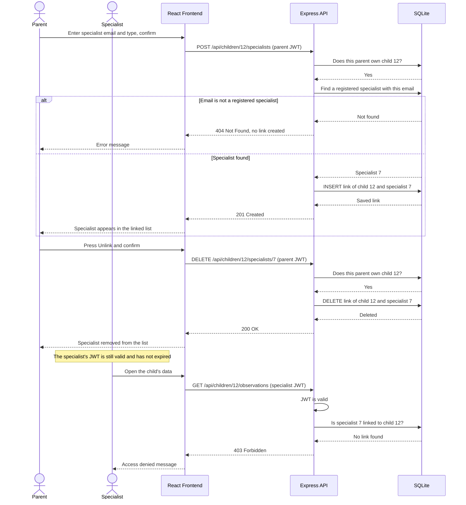

A parent who does not own the child receives `403` on both the link and unlink requests, and no relationship changes.

### Flow 2 – Specialist Assigns a Task and Child Completes It

Related requirements: FR-M1-12, FR-M2-05, FR-M4-01 to FR-M4-10.

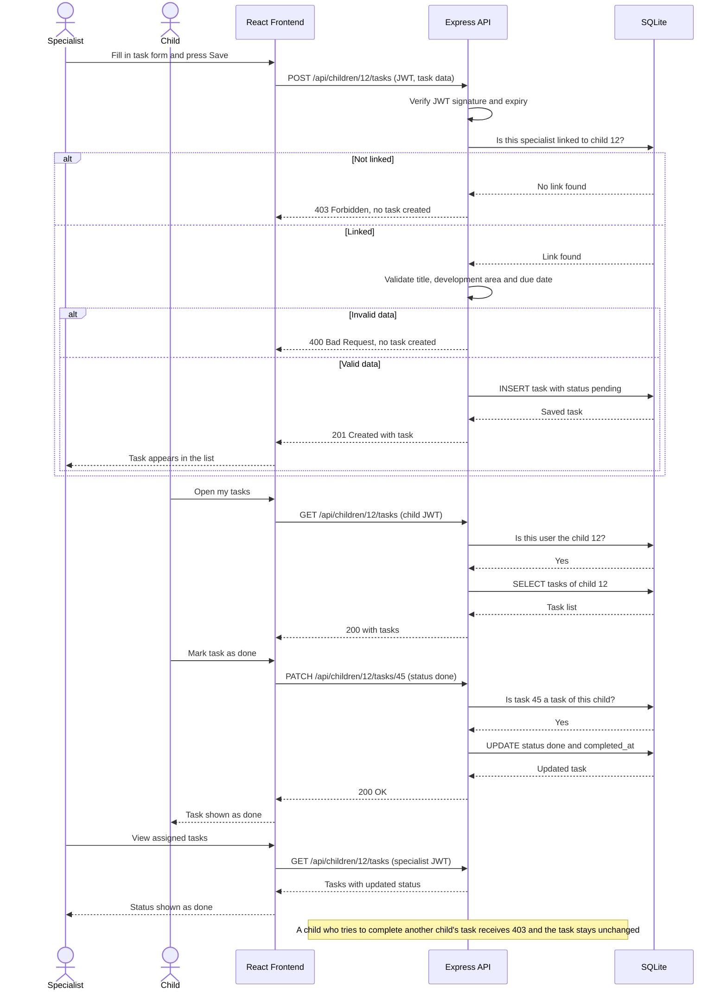

### Flow 3 – Role-Based AI Weekly Summary

Related requirements: FR-M1-11, FR-M2-05, FR-M7-05, FR-M7-06, FR-M8-01 to FR-M8-15, FR-M8-17, FR-M8-18.

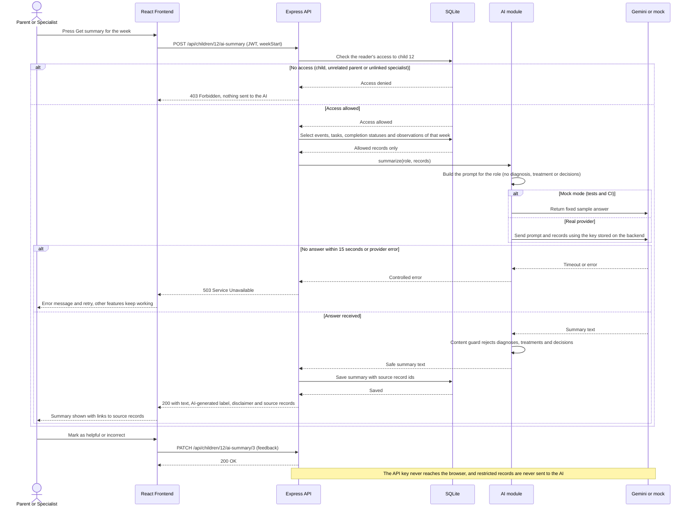

---

## 6. User Interface

The following wireframes\* define the selected screen layouts and use fictional demonstration records. Their grayscale appearance communicates structure rather than final visual styling. The navigation and available actions follow the user's authenticated role; hiding a control never replaces API authorization.

| **Screen**                         | **Image** | **Modules**        |
|------------------------------------|-----------|--------------------|
| WF-01 Sign in\*                    | Figure 2  | M1                 |
| WF-02 Parent weekly dashboard\*    | Figure 3  | M3, M4, M5, M7, M8 |
| WF-03 Child tasks and schedule\*   | Figure 4  | M1, M3, M4         |
| WF-04 Specialist child workspace\* | Figure 5  | M2, M4, M5, M6, M8 |
| WF-05 Assign and track tasks\*     | Figure 6  | M4                 |
| WF-06 Linked specialists\*         | Figure 7  | M2                 |
| WF-07 Documents\*                  | Figure 8  | M6                 |
| WF-08 Weekly schedule\*            | Figure 9  | M3                 |

### Shared Interaction Rules\*

The active child and account role appear in the workspace\*. Changing the child or week refreshes the visible records and clears the previous selection\*.

Forms use persistent labels, visible required-field feedback and a clear primary action\*. Submission disables the action until the request completes\*. Failed requests preserve valid input\*, while a success message appears only after the server confirms the saved change\*. Empty lists state that no matching records exist\*, distinguishing an empty week from a loading failure\*.

Navigation and form actions are keyboard-operable\*, focus indicators remain visible\*, and task states use text labels rather than color alone\*. The child workspace uses larger task controls\* and exposes only tasks and schedule. On narrower browser windows, content panels stack vertically\* without changing permissions or the order of the main actions\*.

### WF-01 Sign in\*

Users enter an email address and password. The account determines the role; there is no role selector. Successful sign-in opens the appropriate role workspace\*. Invalid credentials produce a general error\*, and submission displays a loading state\*.

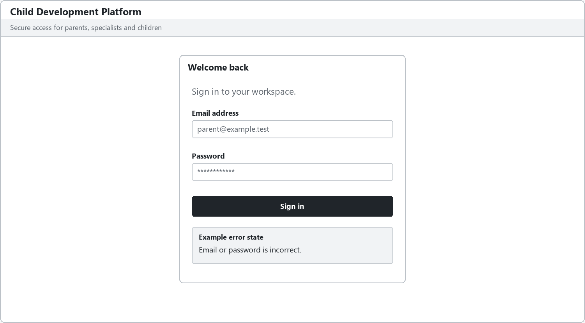

Figure 2 WF 01 Sign in \*

**Design review checks\*:** Each seeded role opens its own workspace. Invalid credentials reveal no account details\*. While a request is pending, the form prevents repeated sign-in submissions\*.

### WF-02 Parent weekly dashboard\*

The parent selects an owned child and a week\* to review events, tasks, recent specialist entries, total completion and completion by development area. Assign task opens WF-05 with the selected child\*. The parent can generate a labeled AI summary\*, inspect its sources and mark it helpful or incorrect. Selecting a source opens the corresponding authorized record\*.

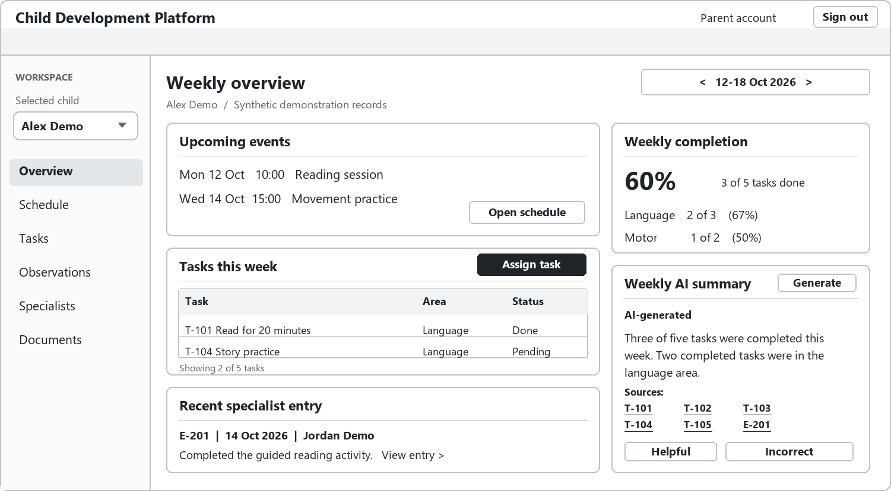

Figure 3 WF 02 Parent weekly dashboard \*

**Design review checks\*:** The displayed child and week govern every panel\*. The synthetic example shows 3/5 completed tasks, including Language 2/3 (67%, rounded) and Motor 1/2 (50%). Every AI source opens an authorized record; switching context removes the previous summary\*.

### WF-03 Child tasks and schedule\*

The child sees only their own tasks and schedule and can mark a task done. A successful update changes the visible status\* and becomes available to the assigner. The child interface provides no observations, documents, specialist management or AI summary.

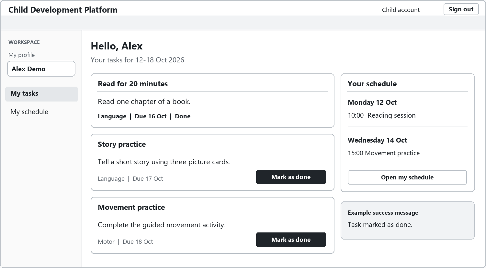

Figure 4 WF 03 Child tasks and schedule \*

**Design review checks\*:** Completing a pending task persists its status and removes the completion action\*. Refreshing retains Done\*. The child cannot open another child's record or reach observations, documents or summaries through direct navigation.

### WF-04 Specialist child workspace\*

The specialist selects a linked child, reads dated observations and adds a new entry. Edited entries display **Edited**. Assign task opens WF-05 and Upload document opens WF-07 for the selected child\*. The specialist can review the weekly AI summary and follow its source links. Loss of the child link clears the workspace and displays an access message\*.

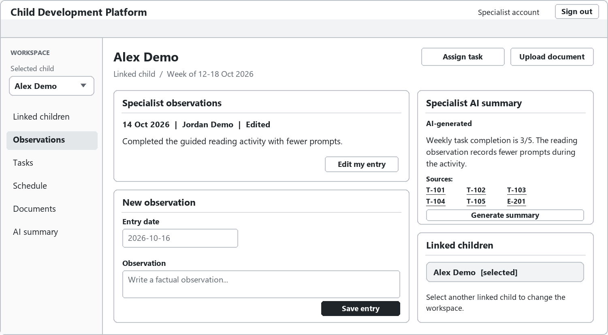

Figure 5 WF 04 Specialist child workspace \*

**Design review checks\*:** Only linked children can be opened. A saved edit displays Edited. Removing the specialist link causes the next child-related request to fail and clears the visible child workspace\*.

### WF-05 Assign and track tasks\*

Parents and linked specialists enter a title, description, development area and due date. WF-05 shows a failed submission with an empty title. The message “Title is required.” appears directly beneath it\*. The other entries remain available for correction\*. The adjacent list\* shows previously assigned tasks and their status.

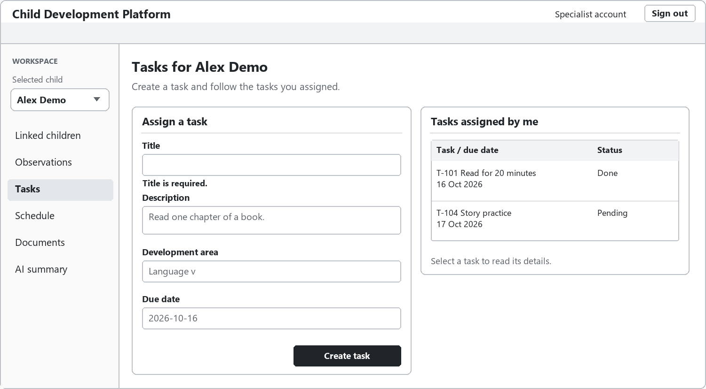

Figure 6 WF 05 Assign and track tasks \*

**Design review checks\*:** An incomplete form creates no task\*. A successful assignment appears in the assigner's list\* and the child's own task list. The assigner sees Done after the child's completion is saved and the list is refreshed\*.

### WF-06 Linked specialists\*

The parent links a registered specialist by email and specialist type, reviews current links and confirms unlinking. An unregistered email produces a clear error. Confirmation uses an inline panel\* explaining that unlinking removes the specialist's access to the child's records.

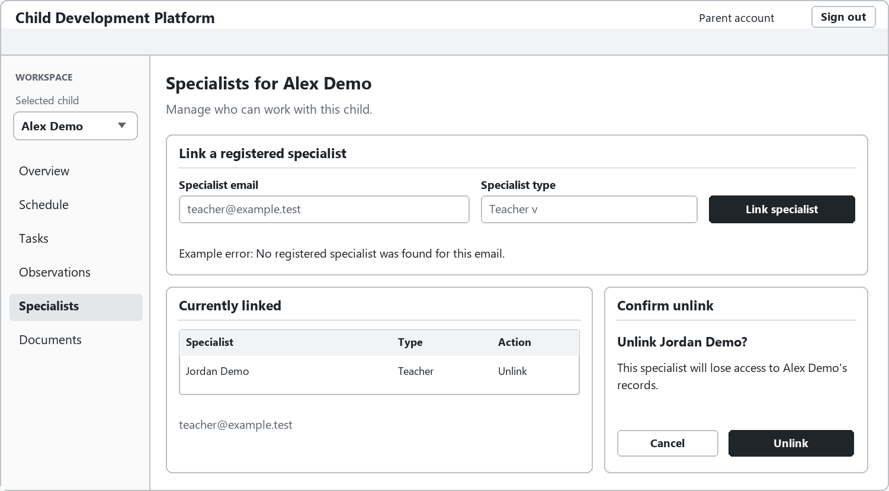

Figure 7 WF 06 Linked specialists \*

**Design review checks\*:** An unregistered email cannot create a link. Canceling confirmation preserves the link\*. Confirming removes access to all of the child's records, including documents and AI source links.

### WF-07 Documents\*

Parents and linked specialists upload, list, view and download PDF or image files. Each row shows the name, type, uploader and date. The upload area shows validation errors\*. Selecting View opens the document preview\*. All linked specialists can access the child's documents; the child cannot.

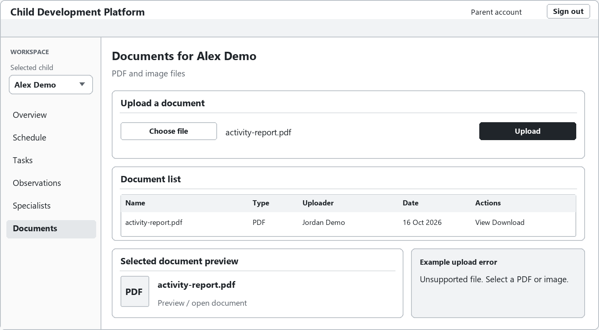

Figure 8 WF 07 Documents \*

**Design review checks\*:** Only a valid PDF or image creates a document row. Download requests recheck child access. A child account or an unlinked specialist receives no file, including when using a previously known download address.

### WF-08 Weekly schedule\*

The selected week's events are grouped by day\*. Parents and linked specialists add events using a panel with a title, date, start time and description\*. Children use a read-only version of their own schedule. Successful creation updates the weekly list\*.

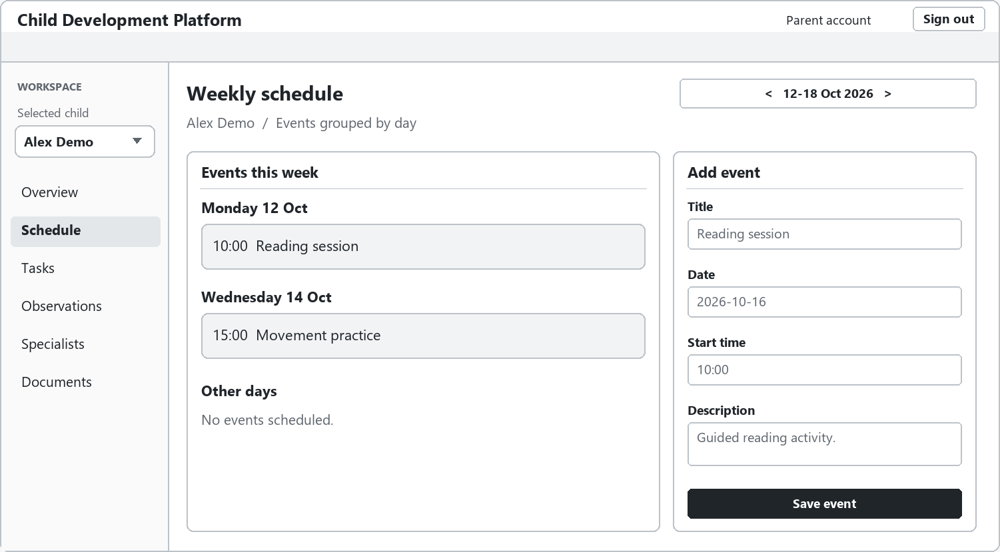

Figure 9 WF 08 Weekly schedule \*

**Design review checks\*:** Saved events appear only in the selected child's matching week\*. An invalid date or time creates no event\*. The child receives a read-only weekly view, with event creation also rejected by the API.

---

## 7. Change Log

| Date | Change | By |
|---|---|---|
| 2026-11-08 | First version: architecture, technology stack and user interface (wireframes); data model, API endpoints and critical flows added | |
| 2026-11-08 | Added module design; aligned data model, API endpoints and critical flows with SRS revision 1.2 | |
