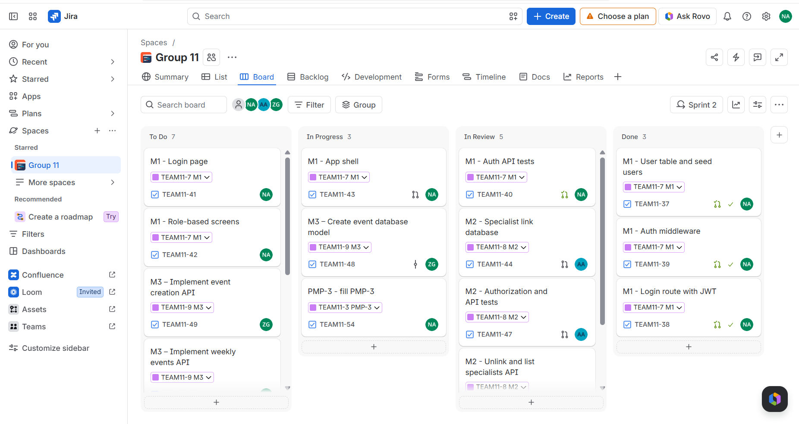
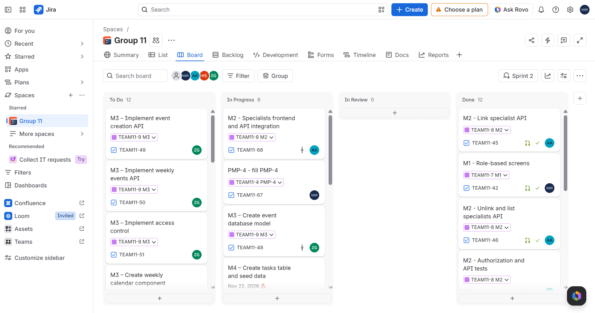

# Project Management Plan (PMP)

| Section | Content | Required by |
|---|---|---|
| PMP-1 | Project, Jira setup, team and roles | Week 6 |
| PMP-2 | Work packages (epics) and sprint plan | Week 6 |
| PMP-3 | Progress review: mid-term (v0.1) | Mid-term evaluation (Week 8 / 9) |
| PMP-4 | Progress review: v0.2 | Week 10 |
| PMP-5 | Progress review: final (v1.0) | Final evaluation |
| PMP-6 | Retrospective | Final evaluation |

---

## PMP-1. Project and Team

### Project and Jira Setup

**Project in one sentence:**  A web-based decision support platform where parents, specialists and children share one schedule, task list and record of observations, with an AI summary for each role that supports decisions but never makes them. 

**Jira project key:**  TEAM11  

**Jira board link:**  https://student-team-i2npn06h.atlassian.net/jira/software/projects/TEAM11/boards/1

### Team and Roles

| Name | Jira / GitHub username | Role |
|---|---|---|
| Nasser Mahamat Adoum  | Nasser Mahamat Adoum / NasserN11 | Project Manager / Developer / Tester |
| Hussein Thakwan Zuhair AL-SAFFAR | Hussein Al Saffar / Hussein-Al-Saffar | Developer / Tester |
| Adeviye AYATA | Adeviye Ayata / Adeviye Ayata | Developer / Tester |
| Kerime Zişan GÖK | zişan gök / zisangok | Developer / Tester |
| | | |

---

## PMP-2. Plan

### Work Packages (Epics)

| Epic | Owner | Number of tasks | Planned sprint(s) |
|---|---|---|---|
| M1 | Nasser |  13 | Sprint 1-2 |
| M2 | Adeviye | 5 | Sprint 2 |
| M3 | Kerime | 6 | Sprint 2 |
| M4 | Hussein | 12 | Sprint 2 |
| M5 | Adeviye | 4 | Sprint 3 |
| M6 | Nasser | 4 | Sprint 3 |
| M7 | Hussein | 4 | Sprint 3 |
| M8 | Kerime | 4 | Sprint 3 |

### Sprint Plan

| Sprint | Weeks | Sprint goal | Ends with |
|---|---|---|---|
| Sprint 1 | 6 | Set up Jira, GitHub and CI; write SRS and SDD drafts, build the walking skeleton; PMP-2 | Walking skeleton (v0.0), Week 6 |
| Sprint 2 | 7-9 | Build login, specialist links, weekly schedule, and tasks; first end-to-end test in CI; live demo to the instructor; PMP-3 and PMP-4 | Release v0.1 (M1-M4), mid-term |
| Sprint 3 | 10 | Build specialist entries, documents, weekly statistics, and role-based AI summary; end-to-end tests for 3 critical flows; final SRS and SDD documents; PMP-5 and PMP-6 | Release v0.2, Week 10 |
| Sprint 4 | 11-12 | Fix bugs; final report; end-to-end tet for each of M1-M8; presentation and live demo | Release v1.0, final |

---

## PMP-3. Progress Review: Mid-term (v0.1)

**Jira board screenshot:**  

| Epic | Planned for this point | Status (Done / In progress / Not started) |
|---|---|---|
| DESIGN | Software design document (first version) | Done (first version) |
| SRS | Software requirements specification document (first version) |  Done (first version) |
| PMP-1 | Project, Jira setup, team and roles, GitHub repo, CI seketon | Done |
| PMP-2 | Epics M1-M8 and sprint pln created | Done |
| PMP-3 | review submitted | Done |
| M1 | Login with JWT, role-based access, app shell, login page | In progress | 
| M2 | Specialist link database, Link/Unlink specialist APIs, API tests | In progress | 
| M3 | Event creation/Weekly events APIs, access control, weekly calendar, event database model | In progress |
| M4 | Tasks table and seed data, tasks APIs, API tests | In progress | 
| M5-M8, PMP-4-PMP-6 | Planned later (v0.2 and final) | Not sterted |

---

## PMP-4. Progress Review: v0.1

**Jira board screenshot:**

| Epic | Planned for this point | Status (Done / In progress / Not started) |
|---|---|---|
| PMP-1 Project, Jira setup, team and roles | Jira, repositories and roles set up | Done |
| PMP-2 Work packages and sprint plan | Epics M1–M8 and sprint plan | Done |
| PMP-3 Progress review | Review submitted | Done |
| M1 Login and roles | Email and password login; each role sees only its own screens | Done |
| M2 Linking specialists | Parent links or unlinks a specialist by email; an unlinked specialist has no access to the child's data (enforced in the API) | Done |
| M3 Weekly schedule | Parent and linked specialists add events, listed in a weekly view | In progress |
| M4 Tasks | Parents and specialists assign tasks, the child marks them done, the assigner sees the status | In progress |
| First end-to-end test in CI | Login flow test running in GitHub Actions | In progress |
| PMP-4 Progress review (v0.1) | This review submitted | Done |
| M5–M8, PMP-5, PMP-6 | Planned for v0.2 and later | Not started |

**Changes to the plan (if any):**
- The Sprint 2 and v0.1 release was extended by one week, to [Sunday 29 November 2026] and Sprint 3 starts on
  [30 November]. The v0.2 date (Week 10) is unchanged, so M5–M8 have less time.
- members who finished v0.1 start the backend of M5–M8 
- Jira was updated to match: sprint dates changed and unfinished cards moved to
  the extended sprint.