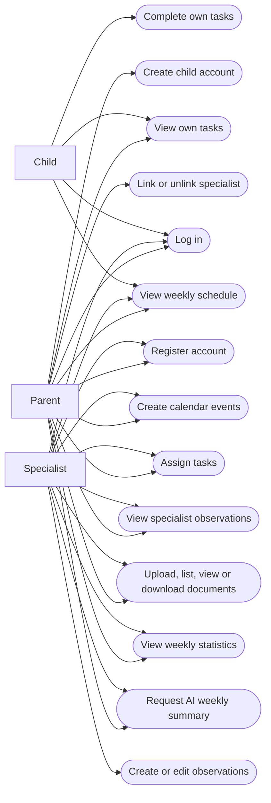

# Software Requirements Specification (SRS)

**Project:** AI-Assisted Child Development Platform  
**Team name:** GrowSync  
**Version:** First version (Week 6) – Revision 1.2  
**Last updated:** 2026-11-08  
**Prepared by:** Adeviye Ayata  
**Student ID:** 202328008  
**Course:** SENG 383 – Software Project III, Fall 2026

**Team members:**
- Adeviye Ayata
- Nasser Mahamat Adoum
- Hussein Thakwan Zuhair AL-SAFFAR
- Kerime Zişan Gök

---

## 1. Introduction

### 1.1 Purpose of the System

The AI-Assisted Child Development Platform is a web-based application that allows parents and specialists to manage children's schedules, tasks, observations, documents, and development statistics in one shared system. It uses role-based access control to protect child records and integrates the Gemini API to generate weekly summaries based on authorized information. AI-generated content supports human decisions but does not provide diagnoses, treatment recommendations, or automatic decisions.

### 1.2 Users of the System

| User type | Description |
|---|---|
| Parent | Owns their child's records, creates child accounts, links specialists, manages schedules and tasks, and views progress and observations. |
| Specialist | A registered teacher, psychologist, doctor, special education teacher, or coach who accesses records of children they are currently linked to. |
| Child | Uses an account associated with a parent to view their own tasks and weekly schedule and mark tasks as completed. |

### 1.3 Scope

The system includes eight mandatory modules:

- M1: Login and Roles
- M2: Linking Specialists
- M3: Weekly Schedule
- M4: Tasks
- M5: Specialist Entries
- M6: Documents
- M7: Weekly Statistics
- M8: Role-Based AI Summary

The application will use React with Vite, Node.js with Express, SQLite, and JWT authentication. Gemini API requests will be handled by a backend module with a mock mode for automated testing.

The application will run locally and use only synthetic data.

### 1.4 Out of Scope

The following features are excluded from the required implementation:

- Mobile applications and cloud deployment
- Email invitations and notification services
- Administrator dashboard
- Field-level and per-document permissions
- Recurring tasks and monthly calendar views
- Full observation edit history
- AI-generated diagnoses, treatments, or automatic decisions
- Docker and microservices

### 1.5 Assumptions and Design Decisions

The following decisions clarify implementation details that are not fully specified in the project assignment.

1. Parent and specialist accounts will be created through a registration form. A parent will create a child account associated with their own account.
2. A child account will belong to one parent account in the first release. The system will not support transferring ownership.
3. Development areas will be Cognitive, Language, Social-Emotional, and Motor.
4. A calendar week shall begin on Monday at 00:00 and end at the following Monday at 00:00 (exclusive), using the Europe/Istanbul timezone.
5. Tasks will be counted in weekly statistics according to their due dates. If an authorized assigner changes a task's due date, the statistics for the affected weeks will be recalculated.
6. AI summaries will use authorized calendar events, tasks, task completion statuses, and specialist observations from the selected week.
7. Uploaded documents will remain accessible through M6, but their file contents will not be sent to the Gemini API.
8. The system will support PDF, PNG, and JPEG uploads with a maximum size of 10 MB per file.
9. Specialist observations shall be included in the selected week's AI summary according to their observation dates.
10. Calendar events that cross a week boundary shall be assigned to the week containing their start date and time.
11. Specialist observations will be included in both parent and specialist AI summaries because both roles are authorized to view these records. This decision requires team confirmation.

These are proposed design decisions for GrowSync and should be approved by the team before implementation.

### 1.6 Glossary

| Term | Definition |
|---|---|
| Parent | Account holder who owns and manages a child's records. |
| Specialist | Registered professional linked to a child by a parent. |
| Child account | Account associated with a parent and restricted to the child's own tasks and schedule. |
| Development area | Category used to classify tasks and calculate statistics: Cognitive, Language, Social-Emotional, or Motor. |
| Calendar week | Monday 00:00 to the following Monday 00:00 (exclusive), Europe/Istanbul timezone. |
| Weekly completion rate | Percentage of tasks due in a selected week that are marked completed. |
| JWT | JSON Web Token used for authenticated API requests. |
| AI-generated summary | Weekly summary generated through Gemini API using authorized records. |
| Mock AI | Test mode returning controlled responses without calling Gemini API. |
| Source records | Original tasks, events, and observations used to generate an AI summary. |

---

## 2. Functional Requirements

### M1 – Login, Registration and Roles

| ID | Requirement | Priority |
|---|---|---|
| FR-M1-01 | The system shall allow registered users to log in using an email address and password. | Must |
| FR-M1-02 | The system shall verify credentials and issue a signed JWT after successful authentication. | Must |
| FR-M1-03 | The system shall determine the user's role from the registered account rather than allowing role selection during login. | Must |
| FR-M1-04 | The system shall display role-specific screens for parents, specialists, and children. | Must |
| FR-M1-05 | The system shall reject unauthenticated requests to protected API endpoints. | Must |
| FR-M1-06 | The system shall allow new parents and specialists to register using a unique email address and password. | Must |
| FR-M1-07 | The system shall allow an authenticated parent to create a child account with a unique username and password. | Must |
| FR-M1-08 | The system shall associate each newly created child account with the parent who created it. | Must |
| FR-M1-09 | The system shall allow children to log in using their registered username and password. | Must |
| FR-M1-10 | The system shall reject registration attempts using an already registered email address or username. | Must |
| FR-M1-11 | The system shall verify child ownership before allowing a parent to read or modify child records through the API. | Must |
| FR-M1-12 | The system shall prevent children from accessing another child's records or parent- and specialist-only functions. | Must |

### M2 – Linking Specialists

| ID | Requirement | Priority |
|---|---|---|
| FR-M2-01 | The system shall allow a parent to link a registered specialist to their own child using the specialist's email address and specialist type. | Must |
| FR-M2-02 | The system shall display the specialists linked to the selected child. | Must |
| FR-M2-03 | The system shall allow a parent to unlink a specialist after confirmation. | Must |
| FR-M2-04 | The system shall reject a linking request if the email address does not belong to a registered specialist. | Must |
| FR-M2-05 | The system shall verify the current specialist-child relationship before allowing access to the child's protected records. | Must |
| FR-M2-06 | The system shall immediately reject further access to a child's records from an unlinked specialist, even when the specialist has a valid JWT. | Must |
| FR-M2-07 | The system shall prevent a parent from linking or unlinking specialists for a child they do not own. | Must |
| FR-M2-08 | The system shall prevent duplicate active links between the same specialist and child. | Should |

### M3 – Weekly Schedule

| ID | Requirement | Priority |
|---|---|---|
| FR-M3-01 | The system shall allow parents to create calendar events for their own children. | Must |
| FR-M3-02 | The system shall allow linked specialists to create calendar events for their linked children. | Must |
| FR-M3-03 | The system shall display events in a Monday-to-Sunday weekly view. | Must |
| FR-M3-04 | The system shall allow children to view only their own weekly schedule. | Must |
| FR-M3-05 | The system shall store calendar events persistently in SQLite. | Must |
| FR-M3-06 | The system shall store each event's title, start date and time, end date and time, creator, and associated child. | Must |
| FR-M3-07 | The system shall reject an event whose end time is not later than its start time. | Must |
| FR-M3-08 | The system shall allow the event creator to edit or delete an event while they remain authorized to access the child. | Should |
| FR-M3-09 | The system shall prevent unauthorized users from creating, editing, deleting, or viewing a child's events. | Must |

### M4 – Tasks

| ID | Requirement | Priority |
|---|---|---|
| FR-M4-01 | The system shall allow parents and linked specialists to assign tasks to authorized children. | Must |
| FR-M4-02 | The system shall store each task's title, description, development area, due date, assigning user, assigned child, and completion status. | Must |
| FR-M4-03 | The system shall allow children to view their own assigned tasks. | Must |
| FR-M4-04 | The system shall allow a child to mark their own task as completed. | Must |
| FR-M4-05 | The system shall display the updated task status to the assigning parent or specialist. | Must |
| FR-M4-06 | The system shall reject task creation requests from specialists who are not linked to the selected child. | Must |
| FR-M4-07 | The system shall restrict the development area field to Cognitive, Language, Social-Emotional, or Motor. | Must |
| FR-M4-08 | The system shall initially save newly assigned tasks with a pending status. | Must |
| FR-M4-09 | The system shall prevent a child from modifying another child's task or changing task assignment details. | Must |
| FR-M4-10 | The system shall allow authorized assigners to view tasks they created and their completion statuses. | Must |
| FR-M4-11 | The system shall allow the assigning parent or currently linked specialist to update the due date of a task they created. | Should |

### M5 – Specialist Entries

| ID | Requirement | Priority |
|---|---|---|
| FR-M5-01 | The system shall allow linked specialists to create dated observations for their linked children. | Must |
| FR-M5-02 | The system shall store each observation's date, content, author, and associated child. | Must |
| FR-M5-03 | The system shall allow the authoring specialist to edit their observation while the specialist remains linked to the child. | Must |
| FR-M5-04 | The system shall display an "edited" label when an observation has been modified. | Must |
| FR-M5-05 | The system shall prevent children from viewing specialist observations. | Must |
| FR-M5-06 | The system shall allow the owning parent and currently linked specialists to view the child's observations. | Must |
| FR-M5-07 | The system shall prevent an unlinked specialist from viewing or modifying the child's observations. | Must |

### M6 – Documents

| ID | Requirement | Priority |
|---|---|---|
| FR-M6-01 | The system shall allow the owning parent and linked specialists to upload PDF, PNG, or JPEG documents associated with a child. | Must |
| FR-M6-02 | The system shall store document metadata including file name, type, uploader, upload date, and associated child. | Must |
| FR-M6-03 | The system shall display a list of documents to the owning parent and currently linked specialists. | Must |
| FR-M6-04 | The system shall allow authorized users to view and download uploaded documents. | Must |
| FR-M6-05 | The system shall reject unsupported file types and files larger than 10 MB. | Must |
| FR-M6-06 | The system shall prevent children and unlinked specialists from viewing, listing, or downloading documents. | Must |
| FR-M6-07 | The system shall validate uploaded file content and type on the backend rather than trusting the file extension alone. | Must |

### M7 – Weekly Statistics

| ID | Requirement | Priority |
|---|---|---|
| FR-M7-01 | The system shall calculate the total task completion rate for a selected calendar week. | Must |
| FR-M7-02 | The system shall calculate completion rates separately for Cognitive, Language, Social-Emotional, and Motor tasks. | Must |
| FR-M7-03 | The system shall calculate each completion rate as completed tasks divided by total tasks due in the selected week, multiplied by 100. | Must |
| FR-M7-04 | The system shall display weekly statistics to the owning parent and currently linked specialists. | Must |
| FR-M7-05 | The system shall use the task due date to determine which week includes the task. | Must |
| FR-M7-06 | The system shall use Monday 00:00 through the following Monday 00:00, excluding the end boundary, in the Europe/Istanbul timezone to identify a calendar week. | Must |
| FR-M7-07 | The system shall display "No tasks" instead of a percentage when no tasks exist for the selected week or development area. | Must |
| FR-M7-08 | The system shall update completion statistics after a task's completion status changes. | Must |
| FR-M7-09 | The system shall recalculate weekly statistics for the affected weeks when an authorized user changes a task's due date. | Must |

### M8 – Role-Based AI Summary

| ID | Requirement | Priority |
|---|---|---|
| FR-M8-01 | The system shall allow the owning parent and currently linked specialists to request AI-generated summaries for a selected week. | Must |
| FR-M8-02 | The system shall use separate Gemini API prompts for parents and specialists. | Must |
| FR-M8-03 | The system shall include only records that the requesting user is authorized to access. | Must |
| FR-M8-04 | The system shall clearly display the label "AI-generated" on every summary. | Must |
| FR-M8-05 | The system shall display references to the source records used to generate the summary. | Must |
| FR-M8-06 | The system shall include instructions in both AI prompts prohibiting diagnoses, treatment recommendations, and automatic decisions. | Must |
| FR-M8-07 | The system shall display the fixed disclaimer "This AI-generated summary is informational and does not replace professional judgment." with each summary. | Must |
| FR-M8-08 | The system shall send Gemini API requests through a single backend module without exposing the API key to the frontend. | Must |
| FR-M8-09 | The system shall provide a mock AI mode for deterministic automated tests and CI without external API calls. | Must |
| FR-M8-10 | The system shall display an error message if the Gemini API fails or exceeds the configured timeout. | Must |
| FR-M8-11 | The system shall include tasks, completion statuses, calendar events, and specialist observations from the selected week in the summary input. | Must |
| FR-M8-12 | The system shall include specialist observations in both parent and specialist summaries because both roles are authorized to view these records. | Must |
| FR-M8-13 | The system shall exclude uploaded document contents and records outside the selected week from AI requests. | Must |
| FR-M8-14 | The system shall reject AI summary requests from children, unrelated parents, and unlinked specialists. | Must |
| FR-M8-15 | The system shall use mock tests with prohibited-content examples to verify that generated summaries do not present diagnoses, treatment recommendations, or automatic decisions. | Must |
| FR-M8-16 | The system shall display a feedback option allowing authorized users to mark an AI summary as helpful or incorrect. | Should |
| FR-M8-17 | The system shall select specialist observations for AI summaries according to their observation dates within the selected week. | Must |
| FR-M8-18 | The system shall select calendar events for AI summaries according to their start date and time within the selected week, including events that end in the following week. | Must |

---

## 3. Non-Functional Requirements

| ID | Category | Requirement |
|---|---|---|
| NFR-01 | Performance | At least 95% of task-list and weekly-schedule API requests shall complete within 2 seconds during a local test of 100 requests using the seeded database. |
| NFR-02 | Security | All passwords shall be stored as salted, one-way hashes. Protected API endpoints shall verify authentication and role-based authorization. |
| NFR-03 | Data Privacy | The system shall use only synthetic data generated by a seed script for development, testing, and demonstrations. No real personal data shall be used. |
| NFR-04 | Reliability | Successfully saved tasks, observations, and calendar events shall remain available after the application restarts. |
| NFR-05 | Testability | Automated tests shall achieve at least 40% branch coverage for v0.2 and 60% branch coverage for v1.0. |
| NFR-06 | AI Timeout | The backend shall stop waiting for a Gemini API response after 15 seconds and return a controlled error response without exposing internal credentials. |
| NFR-07 | JWT Security | Authentication tokens shall expire no later than 60 minutes after issuance, and expired tokens shall be rejected by protected endpoints. |
| NFR-08 | Browser Compatibility | Core login, schedule, task, and document functions should operate in the latest stable versions of Chrome, Firefox, and Safari. |
| NFR-09 | Child Usability | A child should be able to open their task list and mark a pending task as completed in no more than three actions after login. |

---

## 4. Critical Flows and Acceptance Criteria

### Flow 1 – Parent Links and Unlinks a Specialist

**Related requirements:** FR-M1-01, FR-M1-02, FR-M1-11, FR-M2-01, FR-M2-02, FR-M2-03, FR-M2-04, FR-M2-05, FR-M2-06, FR-M2-07

**Scenario 1: Successful Specialist Linking**

- **Given** a parent is authenticated, owns the selected child, and the specialist is registered,
- **When** the parent enters the specialist's email address, selects the specialist type, and confirms the action,
- **Then** the system shall create the relationship and display the specialist in the linked specialists list.

**Scenario 2: Unregistered Specialist**

- **Given** a parent is authenticated and owns the selected child,
- **When** the parent enters an email address that does not belong to a registered specialist,
- **Then** the system shall reject the request, display an error, and create no relationship.

**Scenario 3: Access Revocation**

- **Given** a specialist is linked to a child and holds a valid JWT,
- **When** the owning parent unlinks the specialist,
- **Then** all subsequent API requests from that specialist for the child's protected records shall be rejected.

**Scenario 4: Unauthorized Parent**

- **Given** a parent does not own the selected child,
- **When** that parent attempts to link or unlink a specialist,
- **Then** the system shall reject the request without modifying any relationship.

### Flow 2 – Specialist Assigns a Task and Child Completes It

**Related requirements:** FR-M1-12, FR-M2-05, FR-M4-01, FR-M4-02, FR-M4-03, FR-M4-04, FR-M4-05, FR-M4-06, FR-M4-07, FR-M4-08, FR-M4-09, FR-M4-10

**Scenario 1: Successful Task Assignment**

- **Given** a specialist is authenticated and linked to the selected child,
- **When** the specialist enters a task title, description, one of the four development areas, and a due date,
- **Then** the system shall create the task with a pending status and display it in the child's task list.

**Scenario 2: Task Completion**

- **Given** a child is authenticated and has a pending task,
- **When** the child marks the task as completed,
- **Then** the system shall update the task status and display the completed status to the assigning specialist.

**Scenario 3: Unauthorized Task Assignment**

- **Given** a specialist is not linked to the selected child,
- **When** the specialist attempts to assign a task,
- **Then** the system shall reject the request and shall not create the task.

**Scenario 4: Invalid Development Area**

- **Given** an authorized specialist is creating a task,
- **When** the specialist submits a development area outside the four supported values,
- **Then** the system shall reject the task and display a validation error.

**Scenario 5: Unauthorized Task Completion**

- **Given** a child is authenticated and a task belongs to another child,
- **When** the authenticated child attempts to mark that task as completed,
- **Then** the system shall reject the request and leave the task's completion status unchanged.

### Flow 3 – Role-Based AI Weekly Summary

**Related requirements:** FR-M1-11, FR-M2-05, FR-M7-05, FR-M7-06, FR-M8-01, FR-M8-02, FR-M8-03, FR-M8-04, FR-M8-05, FR-M8-06, FR-M8-07, FR-M8-08, FR-M8-09, FR-M8-10, FR-M8-11, FR-M8-12, FR-M8-13, FR-M8-14, FR-M8-15, FR-M8-17, FR-M8-18

**Scenario 1: Successful AI Summary**

- **Given** an authenticated parent owns the selected child or an authenticated specialist is linked to that child, and the selected week contains records,
- **When** the user requests an AI weekly summary,
- **Then** the system shall use the correct role-specific prompt and authorized weekly records, display an "AI-generated" summary, show the disclaimer, and provide references to its source records.

**Scenario 2: Unauthorized AI Request**

- **Given** a specialist is not linked to the selected child,
- **When** the specialist requests an AI summary,
- **Then** the system shall reject the request before sending any child records to Gemini API.

**Scenario 3: AI Service Timeout**

- **Given** the Gemini API does not respond within 15 seconds,
- **When** an authorized user requests a summary,
- **Then** the system shall return a controlled timeout error and keep all non-AI features accessible.

**Scenario 4: Restricted AI Content**

- **Given** mock AI testing is enabled,
- **When** a mock response contains a diagnosis, treatment recommendation, or automatic decision,
- **Then** the system shall reject or replace the prohibited response with a safe error message rather than display it as an approved summary.

### Critical Flow Summary

| Flow | Related requirements | Acceptance criteria |
|---|---|---|
| Flow 1: Specialist Linking | FR-M1-01, FR-M1-02, FR-M1-11, FR-M2-01 to FR-M2-07 | **Given** an authenticated parent owns a child, **When** the parent links and later unlinks a registered specialist, **Then** the relationship shall be updated and the unlinked specialist shall lose access. |
| Flow 2: Task Assignment and Completion | FR-M1-12, FR-M2-05, FR-M4-01 to FR-M4-10 | **Given** a linked specialist assigns a valid task, **When** the child completes it, **Then** the task status shall update and the assigner shall see the result. |
| Flow 3: AI Weekly Summary | FR-M1-11, FR-M2-05, FR-M7-05 to FR-M7-06, FR-M8-01 to FR-M8-15, FR-M8-17 to FR-M8-18 | **Given** an authorized user selects a week, **When** a summary is requested, **Then** the system shall use only authorized records and display a labelled, source-linked summary or a controlled error. |

---

## 5. Use Case Diagram (Optional)

---

## 6. Change Log

| Date | Change | By |
|---|---|---|
| 2026-11-08 | Created initial SRS covering M1-M8, non-functional requirements, critical flows, and use case diagram. | Adeviye Ayata (202328008) |
| 2026-11-08 | Revision 1.1: Added account creation, parent ownership checks, development area definitions, weekly calculation rules, AI input scope, document validation, measurable security and usability requirements, and revised acceptance criteria and diagram. | Adeviye Ayata (202328008) |
| 2026-11-08 | Revision 1.2: Clarified weekly boundaries, observation and event date rules, due date updates, child task authorization, and AI source selection. | Adeviye Ayata (202328008) |
